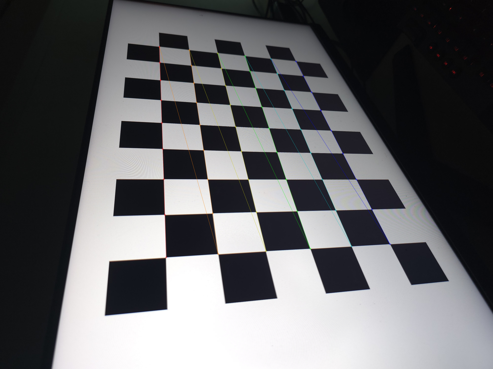
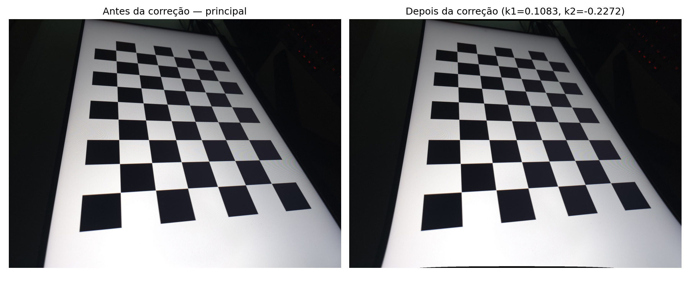
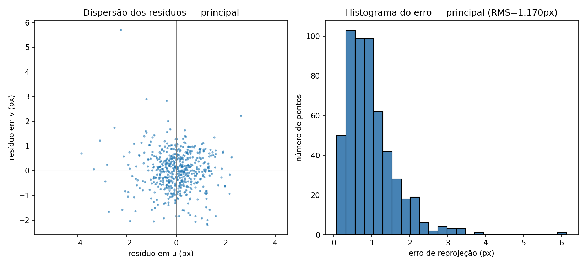

# Calibração de câmeras pelo método de Zhang — Atividade 01

Visão Computacional — UFPI, 2026.2 — Prof. Kelson Aires

## 1. Introdução

Este trabalho implementa, do zero em Python, o método de calibração de câmeras proposto por Zhang [Z. Zhang, "A Flexible New Technique for Camera Calibration", MSR-TR-98-71] e o aplica a duas câmeras traseiras de um **Samsung Galaxy S24 Ultra**: a **principal (1x)** e a **ultra-wide (0.6x)**.

O foco do relatório é a **implementação**: cada etapa do método é descrita junto com o trecho de código correspondente e a seção/equação do artigo em que se baseia. Os resultados numéricos, a Questão 1 e a comparação com o fabricante aparecem apenas no final (Seção 5).

O OpenCV é usado em só dois pontos: para **detectar os cantos** do tabuleiro nas fotos e, no fim, como **conferência** (`cv2.calibrateCamera`). Todo o resto (homografias, solução fechada, extrínsecos, distorção e otimização) foi escrito com NumPy e SciPy.

## 2. Fundamentação

### 2.1 Modelo de câmera

Um ponto 3D $\mathbf{M} = [X, Y, Z]^T$ é projetado no pixel $\mathbf{m} = [u, v]^T$ pelo modelo pinhole (eq. 1 do artigo):

$$s\,\tilde{\mathbf{m}} = \mathbf{A}\,[\mathbf{R}\;\;\mathbf{t}]\,\tilde{\mathbf{M}}, \qquad \mathbf{A} = \begin{bmatrix} \alpha & \gamma & u_0 \\ 0 & \beta & v_0 \\ 0 & 0 & 1 \end{bmatrix}$$

- **Intrínsecos** ($\mathbf{A}$): $\alpha$ e $\beta$ são as distâncias focais em pixels nos eixos $u$ e $v$, $\gamma$ é a inclinação (skew) entre os eixos e $(u_0, v_0)$ é o ponto principal.
- **Extrínsecos** ($\mathbf{R}, \mathbf{t}$): a rotação e a translação que levam o sistema do mundo para o da câmera.

### 2.2 A ideia do método

O padrão de calibração é **plano**. Escolhendo o sistema do mundo com $Z = 0$ sobre o tabuleiro, a terceira coluna de $\mathbf{R}$ some e a projeção vira uma **homografia** (eq. 2):

$$s\,\tilde{\mathbf{m}} = \mathbf{H}\,[X, Y, 1]^T, \qquad \mathbf{H} = [\mathbf{h}_1\;\mathbf{h}_2\;\mathbf{h}_3] = \lambda\,\mathbf{A}\,[\mathbf{r}_1\;\mathbf{r}_2\;\mathbf{t}]$$

Como $\mathbf{r}_1$ e $\mathbf{r}_2$ são ortonormais, cada homografia fornece **duas restrições** sobre os intrínsecos (eqs. 3 e 4):

$$\mathbf{h}_1^T \mathbf{B}\, \mathbf{h}_2 = 0, \qquad \mathbf{h}_1^T \mathbf{B}\, \mathbf{h}_1 = \mathbf{h}_2^T \mathbf{B}\, \mathbf{h}_2, \qquad \mathbf{B} = \mathbf{A}^{-T}\mathbf{A}^{-1}$$

$\mathbf{B}$ é simétrica e tem 6 incógnitas, definidas a menos de escala. Com **3 ou mais fotos** do tabuleiro em orientações diferentes, é possível resolver para $\mathbf{B}$ e, a partir dela, recuperar $\mathbf{A}$. Esse é o núcleo do método.

## 3. Coleta dos dados

- **Padrão:** tabuleiro de 10×7 quadrados (**9×6 cantos internos**) exibido em tela cheia num monitor de 24" (1920×1080, pixel ≈ 0,2767 mm). O monitor garante um plano perfeito, o que o artigo mostra ser importante (Seção 5.3).
- **Tamanho do quadrado:** 130 px na tela × 0,2767 mm/px ⇒ **s = 36,0 mm**, conferido com régua.
- **Fotos:** 10 por câmera, JPEG 4000×3000, modo Pro com foco manual travado, variando a inclinação do tabuleiro para evitar planos paralelos (configuração degenerada, Seção 4 do artigo).

## 4. Implementação

O código está dividido em três arquivos:

| Arquivo | Conteúdo |
|---|---|
| `zhang.py` | O método de Zhang em si: detecção de cantos, homografia, solução fechada, extrínsecos, distorção, MLE e um autoteste sintético |
| `calibrar.py` | Roda o método nas duas câmeras e gera tabelas e figuras |
| `questao1.py` | Questão 1 e o estudo de caso com os intrínsecos calibrados |

O fluxo segue o resumo da Seção 3.4 do artigo:

| Etapa | Função em `zhang.py` | Referência no artigo |
|---|---|---|
| 1. Pontos do modelo e cantos na imagem | `pontos_modelo`, `detectar_cantos` | Seção 2.2 |
| 2. Homografia de cada foto | `homografia_dlt` | Apêndice A |
| 3. Sistema $\mathbf{V}\mathbf{b} = 0$ | `_vij`, `intrinsecos_fechado` | Seção 3.1, eqs. 7–9 |
| 4. Intrínsecos a partir de $\mathbf{b}$ | `_extrair_A` | Apêndice B |
| 5. Extrínsecos de cada foto | `extrinsecos` | Seção 3.1 e Apêndice C |
| 6. Distorção radial (linear) | `distorcao_linear` | Seção 3.3, eq. 13 |
| 7. Refinamento por máxima verossimilhança | `refinar_mle` | Seção 3.2/3.3, eq. 14 |

As etapas 2 a 6 formam a **solução fechada** (rápida, sem iterações, mas minimizando um erro algébrico). A etapa 7 é o **refinamento MLE**, que parte da solução fechada e minimiza o erro de reprojeção em pixels. A função `calibrar` encadeia tudo.

### 4.1 Pontos do modelo e detecção dos cantos

Os pontos do modelo são a grade de cantos no plano $Z = 0$, em milímetros, gerada na mesma ordem em que o OpenCV varre o tabuleiro:

```python
def pontos_modelo(nx, ny, s):
    xs = np.arange(nx, dtype=float) * s
    ys = np.arange(ny, dtype=float) * s
    X, Y = np.meshgrid(xs, ys)          # X varia mais rápido
    return np.column_stack([X.ravel(), Y.ravel()])
```

A detecção usa `cv2.findChessboardCorners` numa cópia da foto reduzida a 40% (em 12 MP a detecção direta é muito lenta). Os cantos são então reescalados e refinados com `cv2.cornerSubPix` (janela 11×11) **na resolução original**, o que dá precisão subpixel. Se o detector padrão falhar, há um retrocesso para `findChessboardCornersSB`, que é mais robusto.

As fotos são lidas com `cv2.IMREAD_IGNORE_ORIENTATION`, ou seja, no referencial nativo do sensor (4000×3000, paisagem), sem aplicar a rotação do EXIF. Todas as 20 fotos tinham a mesma orientação, então o referencial é consistente.

**Resultado:** 10/10 fotos aceitas em cada câmera, todas pelo detector padrão.



### 4.2 Homografia de cada foto (Apêndice A)

Cada par de pontos (modelo ↔ imagem) gera duas equações lineares nas 9 entradas de $\mathbf{H}$. Empilhando todos os pontos, obtém-se o sistema $\mathbf{L}\mathbf{x} = 0$ ($\mathbf{L}$ de tamanho $2n \times 9$), resolvido pelo vetor singular direito associado ao menor valor singular (DLT).

Como o próprio artigo alerta, $\mathbf{L}$ é mal condicionada: as coordenadas em pixels são da ordem de milhares, enquanto a coordenada homogênea é 1. Por isso os dois conjuntos de pontos são antes **normalizados pelo método de Hartley** (centróide na origem e distância média $\sqrt{2}$), e a normalização é desfeita depois:

```python
Mn, Tm = _normalizar_hartley(M)       # pontos do modelo
mn, Ti = _normalizar_hartley(m)       # pontos da imagem

L = np.zeros((2 * n, 9))
for i in range(n):
    X, Y = Mn[i];  u, v = mn[i]
    Mtil = np.array([X, Y, 1.0])
    L[2*i,   0:3] = Mtil;  L[2*i,   6:9] = -u * Mtil
    L[2*i+1, 3:6] = Mtil;  L[2*i+1, 6:9] = -v * Mtil

_, _, Vt = np.linalg.svd(L)
Hn = Vt[-1].reshape(3, 3)
H = np.linalg.inv(Ti) @ Hn @ Tm       # desfaz a normalização
```

Em seguida, $\mathbf{H}$ é **refinada por Levenberg-Marquardt**, minimizando a distância em pixels entre os pontos detectados e os pontos projetados por $\mathbf{H}$. Essa é a estimativa de máxima verossimilhança descrita no Apêndice A, supondo ruído igual em todos os pontos.

### 4.3 Montagem e solução de Vb = 0 (Seção 3.1)

As duas restrições de cada homografia são escritas como equações lineares no vetor $\mathbf{b} = [B_{11}, B_{12}, B_{22}, B_{13}, B_{23}, B_{33}]^T$, usando os vetores $\mathbf{v}_{ij}$ (eq. 7):

$$\begin{bmatrix} \mathbf{v}_{12}^T \\ (\mathbf{v}_{11} - \mathbf{v}_{22})^T \end{bmatrix} \mathbf{b} = 0$$

```python
def _vij(H, i, j):
    hi, hj = H[:, i], H[:, j]
    return np.array([hi[0]*hj[0],
                     hi[0]*hj[1] + hi[1]*hj[0],
                     hi[1]*hj[1],
                     hi[2]*hj[0] + hi[0]*hj[2],
                     hi[2]*hj[1] + hi[1]*hj[2],
                     hi[2]*hj[2]])

linhas = []
for H in Hs:
    linhas.append(_vij(H, 0, 1))
    linhas.append(_vij(H, 0, 0) - _vij(H, 1, 1))
V = np.array(linhas)                  # 2n x 6
_, _, Vt = np.linalg.svd(V)
b = Vt[-1]
```

Dois detalhes de implementação:

- **Condicionamento numérico.** As componentes de $\mathbf{b}$ têm ordens de grandeza muito diferentes ($B_{11} \sim 1/\alpha^2 \approx 10^{-7}$, enquanto $B_{33} \sim 1$), o que prejudica a SVD. Antes de montar $\mathbf{V}$, as homografias são multiplicadas por uma matriz de normalização $\mathbf{N}$ (centra a imagem e divide pelo maior lado), no mesmo espírito da normalização de Hartley. Ao final, a normalização é desfeita: $\mathbf{A} = \mathbf{N}^{-1}\mathbf{A}_{norm}$. Como $\mathbf{N}$ usa a mesma escala nos dois eixos, a estrutura de $\mathbf{A}$ (inclusive $\gamma = 0$, quando for o caso) é preservada.
- **Poucas imagens.** Com $n = 2$ há só 4 equações para 6 incógnitas. Seguindo o artigo, o código adiciona a linha $[0, 1, 0, 0, 0, 0]\,\mathbf{b} = 0$, que impõe $\gamma = 0$.

### 4.4 Extração dos intrínsecos (Apêndice B)

Com $\mathbf{b}$ em mãos, os intrínsecos saem das fórmulas fechadas do Apêndice B:

```python
v0    = (B12*B13 - B11*B23) / (B11*B22 - B12**2)
lam   = B33 - (B13**2 + v0*(B12*B13 - B11*B23)) / B11
alpha = np.sqrt(lam / B11)
beta  = np.sqrt(lam * B11 / (B11*B22 - B12**2))
gamma = -B12 * alpha**2 * beta / lam
u0    = gamma*v0/beta - B13*alpha**2/lam
```

Como a SVD devolve $\mathbf{b}$ com sinal arbitrário, o código verifica se $\lambda / B_{11} < 0$. Nesse caso, troca o sinal de $\mathbf{b}$ e refaz as contas, garantindo raízes quadradas de números positivos.

### 4.5 Extrínsecos de cada foto (Seção 3.1 e Apêndice C)

Conhecida $\mathbf{A}$, os extrínsecos de cada foto saem diretamente da homografia:

$$\mathbf{r}_1 = \lambda\mathbf{A}^{-1}\mathbf{h}_1, \quad \mathbf{r}_2 = \lambda\mathbf{A}^{-1}\mathbf{h}_2, \quad \mathbf{r}_3 = \mathbf{r}_1 \times \mathbf{r}_2, \quad \mathbf{t} = \lambda\mathbf{A}^{-1}\mathbf{h}_3$$

```python
Ainv = np.linalg.inv(A)
lam = 0.5 * (1/np.linalg.norm(Ainv @ h1) + 1/np.linalg.norm(Ainv @ h2))
r1, r2 = lam * Ainv @ h1, lam * Ainv @ h2
r3 = np.cross(r1, r2)
t  = lam * Ainv @ h3
if t[2] < 0:                          # tabuleiro deve estar À FRENTE da câmera
    r1, r2, r3, t = -r1, -r2, -r3, -t
R = _ortogonalizar_rotacao(np.column_stack([r1, r2, r3]))
```

Três cuidados foram necessários:

1. **Escala $\lambda$.** Com ruído, $\|\mathbf{A}^{-1}\mathbf{h}_1\| \neq \|\mathbf{A}^{-1}\mathbf{h}_2\|$. O código usa a média das duas estimativas.
2. **Sinal.** $\mathbf{H}$ é definida a menos de sinal, e a solução "espelhada" colocaria o tabuleiro atrás da câmera. Força-se $t_z > 0$, o mesmo critério ($Z_c > 0$) usado na Questão 1.
3. **Rotação válida.** Por causa do ruído, a matriz $\mathbf{Q} = [\mathbf{r}_1\,\mathbf{r}_2\,\mathbf{r}_3]$ não é exatamente uma rotação. O Apêndice C mostra que a rotação mais próxima (norma de Frobenius) é $\mathbf{R} = \mathbf{U}\mathbf{V}^T$, onde $\mathbf{Q} = \mathbf{U}\mathbf{S}\mathbf{V}^T$. O código também corrige o caso $\det(\mathbf{R}) = -1$.

### 4.6 Distorção radial: estimativa linear (Seção 3.3)

O modelo de distorção considera os dois primeiros termos radiais (eqs. 11–12), aplicados às coordenadas normalizadas $(x, y)$:

$$\breve{x} = x\,(1 + k_1 r^2 + k_2 r^4), \qquad \breve{y} = y\,(1 + k_1 r^2 + k_2 r^4), \qquad r^2 = x^2 + y^2$$

A função `projetar` implementa o modelo completo (pinhole + distorção) e é usada em todo o resto do código.

Com os intrínsecos e extrínsecos da solução fechada, cada canto gera duas equações lineares em $k_1, k_2$ (eq. 13). Empilhando todos os pontos, obtém-se $\mathbf{D}\mathbf{k} = \mathbf{d}$, resolvido por mínimos quadrados:

```python
for i in range(len(M)):
    D.append([(u_id[i]-u0)*r2[i], (u_id[i]-u0)*r2[i]**2])
    D.append([(v_id[i]-v0)*r2[i], (v_id[i]-v0)*r2[i]**2])
    d.append(m_obs[i, 0] - u_id[i])
    d.append(m_obs[i, 1] - v_id[i])
k, *_ = np.linalg.lstsq(np.array(D), np.array(d), rcond=None)
```

Aqui $(u_{id}, v_{id})$ são as projeções ideais (sem distorção) e $(u, v)_{obs}$ são os cantos detectados.

### 4.7 Refinamento por máxima verossimilhança (eq. 14)

A solução fechada é apenas o ponto de partida. A etapa final ajusta **todos os parâmetros ao mesmo tempo** para minimizar o erro de reprojeção:

$$\sum_{i=1}^{n}\sum_{j=1}^{m} \left\| \mathbf{m}_{ij} - \breve{\mathbf{m}}(\mathbf{A}, k_1, k_2, \mathbf{R}_i, \mathbf{t}_i, \mathbf{M}_j) \right\|^2$$

**Parametrização.** Os parâmetros são empacotados num único vetor: 7 intrínsecos ($\alpha, \beta, \gamma, u_0, v_0, k_1, k_2$) mais 6 por foto (3 da rotação e 3 da translação). Com 10 fotos, são **67 parâmetros**, ajustados a partir de 1080 resíduos (10 fotos × 54 cantos × 2 coordenadas).

**Rotações.** Uma matriz de rotação tem 9 números, mas só 3 graus de liberdade. Otimizar os 9 livremente produziria matrizes que não são rotações. Por isso cada rotação é representada pelo **vetor de Rodrigues** (eixo × ângulo, 3 números), como sugere o artigo. A conversão nos dois sentidos (`rodrigues` e `rodrigues_inv`) foi implementada à mão, incluindo o caso degenerado de ângulo próximo de π.

**Otimização.** O Levenberg-Marquardt é o `scipy.optimize.least_squares(method='lm')`, com a função de resíduos:

```python
def residuos(x):
    A, k, Rs, ts = _desempacotar(x, n, fixar_gamma)
    partes = []
    for R, t, M, m_obs in zip(Rs, ts, Mlist, mlist):
        M3 = np.column_stack([M, np.zeros(len(M))])     # Z = 0
        partes.append((projetar(A, k, R, t, M3) - m_obs).ravel())
    return np.concatenate(partes)

res = least_squares(residuos, x0, method="lm", x_scale="jac")
```

**Saídas.** Ao final, o código calcula:

- o **RMS de reprojeção**, $\sqrt{\sum \|\text{resíduo}\|^2 / n_{pontos}}$, em pixels;
- a **incerteza** $\sigma$ de cada parâmetro, a partir do jacobiano na solução: $\text{cov} \approx s^2 (\mathbf{J}^T\mathbf{J})^{-1}$, com $s^2 = \text{SSR} / (\text{n}_{resíduos} - \text{n}_{parâmetros})$. É o equivalente à coluna σ da Tabela 1 do artigo.

Existe também a opção `fixar_gamma=True`, que remove $\gamma$ do vetor de parâmetros. Ela é usada para comparar diretamente com o OpenCV, que sempre assume $\gamma = 0$.

### 4.8 Validação da implementação

A implementação foi validada de duas formas independentes antes de ser usada nas fotos reais.

**1. Câmera sintética** (`python zhang.py`). Uma câmera com parâmetros conhecidos ($\alpha = \beta = 1000$, $u_0 = v_0 = 500$) "fotografa" o tabuleiro em 8 poses; soma-se ruído gaussiano de σ = 0,5 px aos cantos projetados e roda-se a calibração. Os parâmetros recuperados ficam com erro abaixo de 0,2% em $\alpha, \beta$ e da ordem de 1 px em $u_0, v_0$, compatível com a Fig. 1 do artigo.

Um aprendizado desse teste: a configuração literal da Seção 5.1 do artigo (3 planos inclinados só 20°) resultou num sistema $\mathbf{V}$ quase degenerado, muito sensível a ruído. É o mesmo fenômeno da Seção 4 (planos quase paralelos não trazem informação nova). Com inclinações maiores (25°–50°), a solução fica estável. Isso orientou a coleta das fotos reais.

**2. Comparação com o OpenCV.** A mesma calibração foi repetida com `cv2.calibrateCamera` (apenas $k_1, k_2$: flags `CALIB_ZERO_TANGENT_DIST | CALIB_FIX_K3`). Com $\gamma$ fixado em 0, a nossa implementação e o OpenCV **coincidem até a 4ª casa decimal** nas duas câmeras (Seção 5.1).

## 5. Resultados

### 5.1 Parâmetros calibrados

| Parâmetro | Principal: fechada | Principal: MLE | Principal: OpenCV (γ=0) | Ultra-wide: fechada | Ultra-wide: MLE | Ultra-wide: OpenCV (γ=0) |
|---|---|---|---|---|---|---|
| α (px) | 2793,50 | 2754,61 ± 1,82 | 2755,09 | 1641,58 | 1633,99 ± 0,65 | 1634,02 |
| β (px) | 2793,34 | 2749,63 ± 2,04 | 2750,16 | 1641,99 | 1633,55 ± 0,69 | 1633,59 |
| γ | −9,57 | 1,80 ± 0,61 | 0 | −0,22 | 0,07 ± 0,11 | 0 |
| u₀ (px) | 2000,92 | 2015,07 ± 1,13 | 2014,62 | 1996,40 | 1995,66 ± 0,29 | 1995,67 |
| v₀ (px) | 1497,34 | 1497,59 ± 0,98 | 1498,20 | 1462,48 | 1461,09 ± 0,29 | 1461,08 |
| k₁ | −0,0013 | 0,1083 ± 0,0027 | 0,1084 | −0,0033 | 0,0115 ± 0,0006 | 0,0115 |
| k₂ | 0,0283 | −0,2272 ± 0,0085 | −0,2286 | 0,0094 | −0,0055 ± 0,0008 | −0,0055 |
| RMS (px) | 5,388 | **1,170** | 1,176 | 0,979 | **0,535** | 0,535 |

Matrizes intrínsecas finais (MLE):

$$\mathbf{A}_{principal} = \begin{bmatrix} 2754{,}61 & 1{,}80 & 2015{,}07 \\ 0 & 2749{,}63 & 1497{,}59 \\ 0 & 0 & 1 \end{bmatrix}, \qquad \mathbf{A}_{ultra\text{-}wide} = \begin{bmatrix} 1633{,}99 & 0{,}07 & 1995{,}66 \\ 0 & 1633{,}55 & 1461{,}09 \\ 0 & 0 & 1 \end{bmatrix}$$

**Principais observações:**

- **O refinamento MLE vale a pena.** Ele reduz o RMS em ~4,6× na principal (5,39 → 1,17 px) e ~1,8× na ultra-wide (0,98 → 0,54 px). Como no artigo, $k_1$ e $k_2$ trocam de sinal entre a solução fechada e a MLE: a estimativa linear parte de intrínsecos calculados supondo distorção nula, e só a otimização conjunta chega à forma correta.
- **A implementação bate com o OpenCV.** Rodando a nossa MLE com γ fixado em 0 (como o OpenCV faz), os valores coincidem com os do OpenCV até a 4ª casa decimal. A pequena diferença entre as colunas MLE e OpenCV da tabela vem apenas de o γ estar livre na nossa versão.
- **Os parâmetros são fisicamente plausíveis.** $\alpha/\beta$ fica a 0,2% e 0,03% de 1 (pixels quadrados) e $\gamma$ não é significativamente diferente de zero (ângulo entre os eixos ≈ 89,96°), como esperado de um sensor CMOS.
- **A calibração é estável.** Refazendo-a 10 vezes, cada uma sem uma das fotos, $\alpha, \beta, u_0, v_0$ variam menos de 0,2% (coeficiente de variação).
- **A distorção residual é pequena**, sobretudo na ultra-wide. Isso é contraintuitivo, porque lentes ultra-wide costumam ter muita distorção barril. A explicação é que o processamento da Samsung já corrige a distorção no JPEG antes de gravar o arquivo. Os $k_1, k_2$ calibrados descrevem o que **sobra** depois dessa correção, não a lente física.
- **Limitação.** O tabuleiro ocupou sobretudo a região central das fotos, então $k_1, k_2$ são confiáveis ali, mas não devem ser extrapolados para os cantos extremos da imagem.





### 5.2 Questão 1

**Dados do enunciado:** f = 15 mm, sensor 4 × 3 mm, imagem 1280 × 720 px, ponto principal (630, 355). A transformação é dada de câmera para mundo, $\mathbf{P}_w = \mathbf{R}\mathbf{P}_c + \mathbf{T}$, com:

$$\mathbf{R} = \begin{bmatrix} 0 & 1 & 0 \\ 1 & 0 & 0 \\ 0 & 0 & -1 \end{bmatrix}, \qquad \mathbf{T} = [0,\ 0,\ 2000]^T \text{ mm}$$

Logo, $\mathbf{P}_c = \mathbf{R}^T(\mathbf{P}_w - \mathbf{T})$, ou seja, $X_c = Y_w$, $Y_c = X_w$ e $Z_c = 2000 - Z_w$.

**a) Matriz de projeção.** Os fatores de escala são $k_x = 1280/4 = 320$ px/mm e $k_y = 720/3 = 240$ px/mm, então $f_x = 4800$ px e $f_y = 3600$ px:

$$\mathbf{K} = \begin{bmatrix} 4800 & 0 & 630 \\ 0 & 3600 & 355 \\ 0 & 0 & 1 \end{bmatrix}, \qquad \mathbf{P} = \mathbf{K}[\mathbf{R}^T \mid -\mathbf{R}^T\mathbf{T}] = \begin{bmatrix} 0 & 4800 & -630 & 1\,260\,000 \\ 3600 & 0 & -355 & 710\,000 \\ 0 & 0 & -1 & 2000 \end{bmatrix}$$

Para $\mathbf{P}_m = [80, 20, 1200]^T$: $\mathbf{P}_c = [20, 80, 800]^T$, logo $u = 630 + 4800 \cdot 20/800 = 750$ e $v = 355 + 3600 \cdot 80/800 = 715$. O ponto projeta em **(750, 715)**, dentro da imagem.

**b) Os cinco pontos.** A regra aplicada no código (`questao1.analisar_ponto`) é verificar $Z_c > 0$ **antes** de dividir. Um ponto com $Z_c < 0$ está atrás da câmera e não é imageado, mesmo que a conta algébrica produza um pixel.

| Ponto | $\mathbf{P}_w$ (mm) | $Z_c$ (mm) | (u, v) | Resultado |
|---|---|---|---|---|
| P1 | (0, 0, 6500) | −4500 | — | Atrás da câmera |
| P2 | (200, −30, 1500) | 500 | (342, 1795) | À frente, mas **fora da imagem** (v > 720) |
| P3 | (300, −80, 5000) | −3000 | — | Atrás da câmera |
| P4 | (80, 20, 2000) | 0 | — | No plano focal: projeção indefinida |
| P5 | (90, −10, 2500) | −500 | — | Atrás da câmera |

**Estudo de caso: Questão 1 com as câmeras calibradas.** Mantendo $\mathbf{R}$ e $\mathbf{T}$ e trocando $\mathbf{K}$ pelo $\mathbf{A}$ calibrado (limites de 4000 × 3000 px):

| Ponto | Enunciado (1280×720) | Principal (sem → com distorção) | Ultra-wide (sem → com distorção) |
|---|---|---|---|
| Pm | (750; 715), dentro | (2084,1; 1772,6) → (2084,2; 1772,9), dentro | (2036,5; 1624,4) → (2036,5; 1624,5), dentro |
| P2 | (342; 1795), **fora** | (1850,5; 2597,4) → (1848,6; 2610,3), **dentro** | (1897,7; 2114,5) → (1897,5; 2115,6), **dentro** |
| P1, P3, P5 | Atrás da câmera | Atrás da câmera | Atrás da câmera |
| P4 | Plano focal | Plano focal | Plano focal |

- **P1, P3, P4 e P5 não mudam**, porque $Z_c$ depende só dos extrínsecos, e não de $\mathbf{K}$.
- **P2 muda de classificação.** A câmera do enunciado tem campo de visão estreito (15,2° × 11,4°), enquanto as câmeras reais têm 72,0° × 57,2° (principal) e 101,5° × 85,1° (ultra-wide). O mesmo ponto físico fica fora do quadro na primeira e dentro nas outras duas.
- **A distorção pesa mais longe do centro.** Na principal, a correção desloca Pm em ~0,3 px, mas P2, mais afastado do centro, em ~13 px.

### 5.3 Comparação com o fabricante

A Samsung não publica a matriz intrínseca, então a comparação usa a distância focal registrada no EXIF das fotos e o tamanho de pixel da ficha técnica dos sensores. A focal em pixels esperada pelo EXIF é $f_{px} \approx f_{35} \cdot \sqrt{W^2 + H^2} / 43{,}27$, onde 43,27 mm é a diagonal do filme 35 mm.

| Grandeza | Principal (1x) | Ultra-wide (0.6x) |
|---|---|---|
| Focal EXIF (equiv. 35 mm) | 6,30 mm (23 mm) | 2,20 mm (13 mm) |
| Focal esperada em pixels (via EXIF) | 2657,7 px | 1502,2 px |
| α calibrado (MLE) | 2754,6 px (+3,6%) | 1634,0 px (+8,8%) |
| Pixel do sensor (ficha técnica) | 2,4 µm (ISOCELL HP2, 12 MP com binning 4×4) | 1,4 µm (12 MP, 1/2,55") |
| Focal calibrada em mm (α × pixel) | 6,61 mm (+4,9% vs EXIF) | 2,29 mm (+4,0% vs EXIF) |
| Ponto principal calibrado | (2015,1; 1497,6) | (1995,7; 1461,1) |
| Centro da imagem | (2000; 1500) | (2000; 1500) |
| Deslocamento do ponto principal | 15,3 px (0,4% da largura) | 39,2 px (1,0% da largura) |
| α/β | 1,0018 | 1,0003 |

**Interpretação:**

- **Distância focal.** A focal calibrada fica entre 4% e 5% acima do valor do EXIF nas duas câmeras. A diferença é pequena e esperada: o EXIF registra a focal nominal arredondada, e o JPEG passa pela correção de distorção da Samsung, que pode alterar levemente a escala da imagem. A comparação via "35 mm equivalente" é menos precisa (sobretudo na ultra-wide, com focal 13 mm arredondada), por isso a diferença é maior ali.
- **Ponto principal.** Fica a menos de 1% da largura do centro geométrico da imagem nas duas câmeras.
- **Pixels quadrados.** $\alpha/\beta \approx 1$ confirma pixels quadrados, como especificado para os sensores.
- **Tamanho de pixel da ultra-wide.** Há alguma divergência entre fontes sobre esse valor, o que também contribui para a diferença.

## 6. Conclusão

O método de Zhang foi implementado integralmente, etapa por etapa:

- **Homografia** por DLT normalizado, com refino não linear.
- **Solução fechada** dos intrínsecos via $\mathbf{V}\mathbf{b} = 0$ e Apêndice B.
- **Extrínsecos**, com ortogonalização por SVD.
- **Distorção radial** estimada por mínimos quadrados lineares.
- **Refinamento MLE** com Levenberg-Marquardt e rotações em vetor de Rodrigues.

Os pontos que mais exigiram cuidado na implementação foram o **condicionamento numérico** (normalizações antes das SVDs), as **ambiguidades de sinal** (de $\mathbf{b}$ e de $\mathbf{H}$, resolvidas exigindo $t_z > 0$) e a **parametrização das rotações** na otimização.

A implementação foi validada com uma câmera sintética e coincide com o `cv2.calibrateCamera` até a 4ª casa decimal. Aplicada às duas câmeras do S24 Ultra, ela produziu:

- **Erro de reprojeção** subpixel ou próximo disso (1,17 px e 0,54 px).
- **Parâmetros estáveis** entre subconjuntos de fotos.
- **Coerência com o fabricante:** focal de 4% a 5% acima da nominal, ponto principal perto do centro e pixels quadrados.

No estudo de caso da Questão 1, os pontos atrás da câmera continuam não imageáveis para qualquer câmera. Já o ponto P2, fora do quadro da câmera do enunciado, passa a aparecer nas câmeras reais graças ao campo de visão bem mais amplo.
